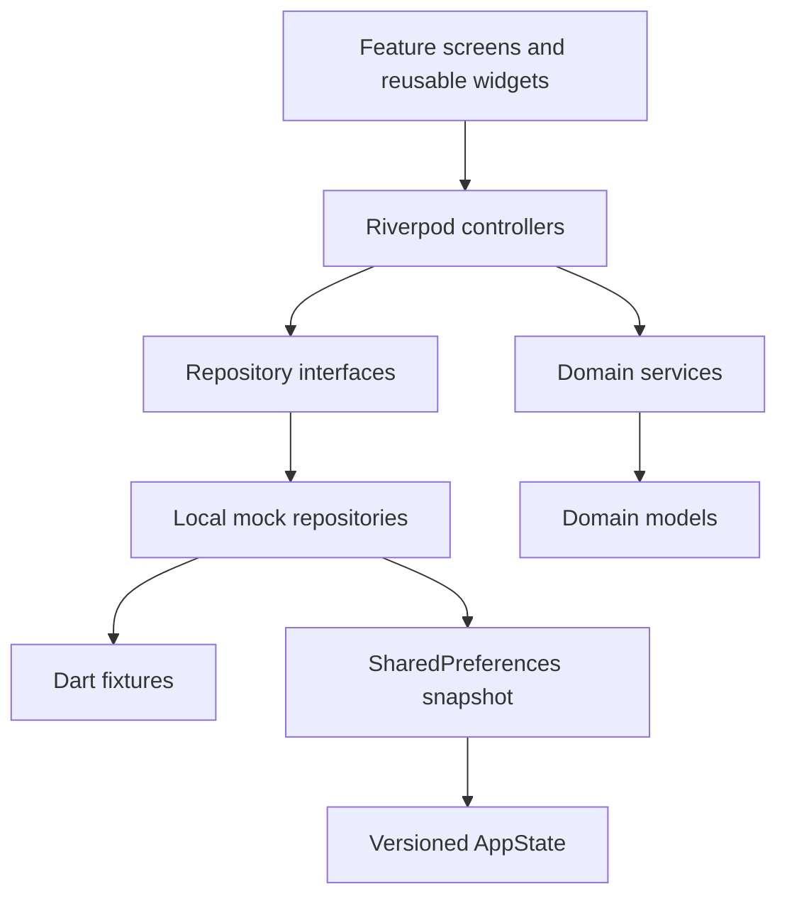
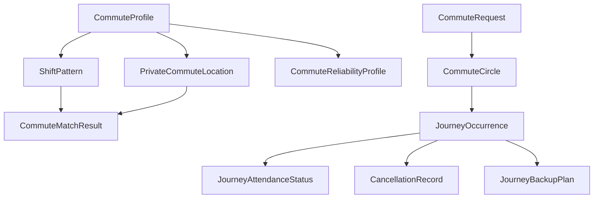
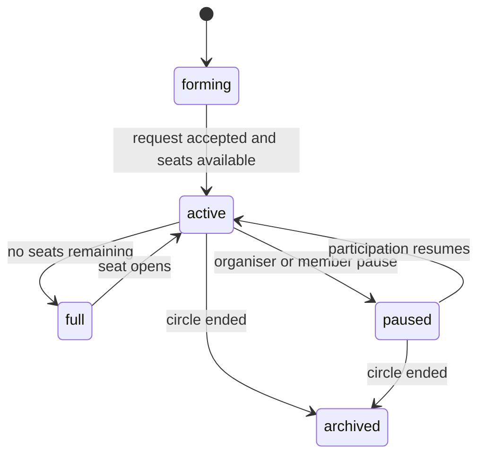
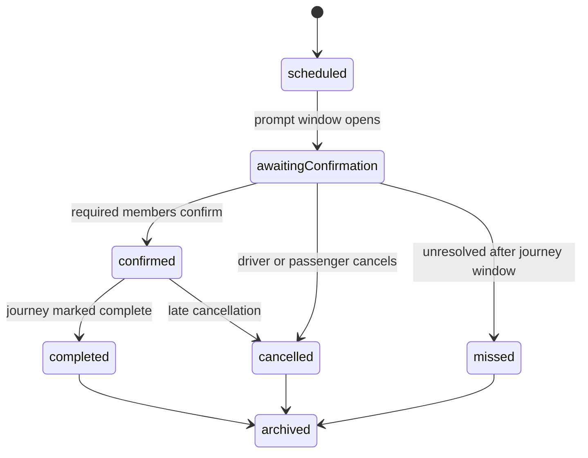

# feat: Build a distinctive workplace commuting vertical slice

## Summary

Transform Coleggo from a competent lift-sharing prototype into a concept-demonstration vertical slice for a private workplace commuting network centred on verified worksites, recurring Commute Circles, shift-aware schedules, explainable matching, privacy-preserving locations, confirmation, cancellation resilience, and behavioural reliability.

The work keeps the local-only Flutter prototype architecture. It strengthens only the domain models, repository boundaries, local persistence, UI journeys, tests, and documentation needed to prove the flagship slice without adding payments, live tracking, chat, public employee search, or a backend.

---

## Problem Frame

Coleggo currently demonstrates onboarding, mock workplace verification, profile setup, deterministic matching, requests, and accepted recurring commutes. It still feels generic because the core experience is arranged around individual matches and requests rather than the stronger product idea: verified colleagues forming dependable recurring journeys around shared work patterns.

The existing code already has useful seams: Material 3, Riverpod, `go_router`, repository interfaces, deterministic Dart fixtures, and one versioned `AppState` snapshot in `shared_preferences`. The plan should extend those seams rather than replacing the stack.

---

## Requirements

### Product Identity

- R1. Position Coleggo as a private workplace commuting network for verified colleagues, not a taxi app, public marketplace, route tracker, social network, or fare product.
- R2. Make Commute Circles the flagship flow, with discovery, details, join request, acceptance, membership, recurring schedule, seat availability, pause, leave, backup driver, activity state, and a clear no-chat-yet placeholder.
- R3. Keep shift workers in scope by supporting named shift templates, adjustable start and end times, arrival buffer, departure window, recurring days, optional rota week, and overnight shifts.
- R4. Show the Home screen as an operational dashboard answering next journey, required confirmation, incoming requests, stronger matches, active circle, and personal reliability within five seconds.

### Trust And Privacy

- R5. Hide exact home addresses, private contact details, precise coordinates, and exact distances from discovery and accepted prototype journeys.
- R6. Model location as approximate area, postcode district, approximate map centre, privacy radius, meeting-point preference, precise sharing state, and proximity category.
- R7. Replace superficial ratings with private-by-default reliability signals and journey-level summaries that never claim safety, character, insurance, licence, background checks, or driving competence.
- R8. Document workplace verification boundaries and discovery rules so users discover compatible commutes, not employee directories.

### Domain Behaviour

- R9. Implement deterministic explainable matching with whole-number scores, eligibility, positive reasons, limitations, match levels, estimated/approximate flags, and the requested 100-point factor weights.
- R10. Separate recurring agreements from date-specific journey occurrences so confirmation, cancellation, missed journeys, completion, and backup plans do not overload request status.
- R11. Improve request quality with request type, intended days, time window, worksite, seats, optional message, one-off vs recurring intent, duplicate prevention, expiration, and transition into a Commute Circle.
- R12. Persist profile, workplace verification, schedules, active circle, requests, attendance, cancellation history, theme, onboarding, and preferences through a versioned persistence boundary.

### Engineering Quality

- R13. Create `docs/standout_product_audit.md` and `docs/standout_implementation_plan.md` before product code changes begin.
- R14. Keep UI dependencies on repositories and services rather than direct fixture access where the feature is repository-backed.
- R15. Represent loading, empty, recoverable failure, retry, and unavailable states for repository-backed screens.
- R16. Add focused unit and widget tests for shift compatibility, matching, requests, circles, confirmations, cancellation, backup selection, reliability, privacy notices, accessibility, and persisted restoration.
- R17. Finish with `docs/product_differentiation.md`, `docs/privacy_product_principles.md`, `docs/domain_model.md`, `docs/future_backend_requirements.md`, and `docs/standout_final_review.md`.
- R18. Define actor and audience boundaries for circle, journey, request, attendance, cancellation, activity and reliability data.
- R19. Classify persisted prototype fields by sensitivity and document retention, deletion, and the future move away from plaintext local storage for production.

---

## Key Technical Decisions

- KTD1. Keep Flutter, Riverpod, `go_router`, `shared_preferences`, and deterministic fixtures: the current stack is sufficient for the requested vertical slice and avoids introducing backend complexity for prototype behaviour.
- KTD2. Add first-class domain models instead of expanding `RideRequest`: Commute Circles, shift patterns, journey occurrences, attendance, cancellations, backup plans, private locations, reliability, and accessibility requirements need distinct lifecycles.
- KTD3. Bump local state to a new schema version with migration: existing v1 snapshots should migrate profile, commute, requests, theme, onboarding, verification, and selected tab, then default new collections safely.
- KTD4. Keep reliability descriptive and non-punitive: signals should be factual summaries and contextual warnings, not a public star rating or hidden trust score.
- KTD5. Treat accepted journeys as still privacy-preserving: the prototype should continue using public meeting-point guidance and should not reveal telephone numbers, private email, exact pickup coordinates, or home addresses after acceptance.
- KTD6. Make journey cancellation single-occurrence by default: leaving or archiving the recurring circle is a separate action, which prevents one bad day from destroying the ongoing arrangement.
- KTD7. Put scoring in a dedicated commute matching service: widgets should render `CommuteMatchResult`, reasons, limitations, and labels, while services own scoring and eligibility rules.
- KTD8. Use system-generated fictional circles for the prototype: circles should come from mock data and broad corridor/worksite/shift compatibility, not user-created public communities or employer-managed groups.
- KTD9. Keep no-chat, no-live-notification placeholders honest: activity records and in-app simulated notifications can demonstrate state changes without pretending real-time infrastructure exists.
- KTD10. Split orchestration by feature before `AppController` absorbs the product: keep `AppController` responsible for restored app state and global setup, then introduce focused controllers for circles and journeys.
- KTD11. Treat repository-backed loading and failure states as product states: local mock repositories should return asynchronous repository results that controllers map into `AsyncValue` or explicit UI state.
- KTD12. Keep the existing `coleggo_app_state_v1` storage key and bump only `schemaVersion` for this slice, so v1 snapshots are discoverable and migratable without a second-key fallback path.
- KTD13. Add new abstractions only when the P0 slice has a current consumer; otherwise keep the behaviour inside the existing service, controller or widget until a second consumer appears.

### Matching Score Weights

| Factor | Points |
|---|---:|
| Same verified worksite | 25 |
| Compatible starting areas | 20 |
| Compatible arrival or departure times | 20 |
| Matching commute days | 15 |
| Compatible driver/passenger roles | 10 |
| Seat availability | 5 |
| Recurring schedule compatibility | 5 |

---

## High-Level Technical Design

### Component Topology

### Core Domain Relationships

### Circle And Journey States

Backup selection creates a new scheduled replacement occurrence. The original cancelled occurrence remains cancelled until archived.

---

## Scope Boundaries

### In Scope

- Audit-first documentation and baseline command recording during implementation.
- Complete local-only vertical slice for Commute Circles, shift-aware matching, privacy, request quality, confirmation, cancellation backup, reliability, dashboard, accessibility, persistence, tests, and docs.
- Fictional mock data that exercises office, care, warehouse, hospital, hybrid, early, late, night, accessibility, cancellations, expired requests, and high/low match states.

### Deferred For Later

- Real authentication, domain verification, invitation codes, backend persistence, multi-device sync, route APIs, maps, push notifications, secure messaging, moderation operations, incident reporting, employer admin tools, analytics, and account deletion.
- Multi-week rota optimisation beyond optional rota week fields and fixture examples.
- Real public transport integration, routing, ETA, live availability, or location tracking.

### Outside This Product's Identity

- Payments, fares, driver earnings, adverts, taxi marketplace language, public employee search, social feeds, facial recognition, identity-document uploads, criminal-record claims, insurance verification claims, employer surveillance dashboards, and generative AI matching.

---

## Resolved Planning Assumptions

- Journey cancellation affects one upcoming occurrence by default; leaving a circle or ending participation is a separate action.
- Journey confirmation means pre-journey intent to travel; completion confirmation is limited to prototype journey history.
- Reliability is descriptive and event-based, with lightweight public summaries and more detail shown to the current user.
- A user may belong to multiple circles, but Home highlights one primary active circle.
- Backup plans use local compatible colleagues and static travel notes, not live routing or transport availability.
- After acceptance, the prototype still does not reveal exact addresses, private email, phone numbers or precise coordinates.

---

## System-Wide Impact

- **State lifecycle:** `AppState` moves from a small setup/request snapshot to the persisted aggregate for profiles, schedules, circles, journeys, attendance, cancellations, reliability, preferences and theme.
- **Navigation:** `lib/app/router.dart` gains routes for circles and journeys while preserving the existing guarded setup flow and shell tabs.
- **Repository contracts:** The current synchronous mock repositories need async-shaped result states for loading, empty and recoverable failures without adding a remote backend.
- **Controllers:** New circle and journey controllers should own feature mutations so `lib/features/state/app_controller.dart` stays focused on global state restoration and setup.
- **Privacy boundary:** Location, profile, match, circle and journey UI should render through shared privacy-safe display models so precise data cannot leak through one-off widgets.
- **Test surface:** Persistence, matching, request transitions, circle membership, attendance, cancellation backup, accessibility and dashboard flows become the regression backbone for future backend work.

---

## Minimum Viable Slice

The P0 slice is deliberately narrower than the full requirement list: one active Commute Circle, one join request path, shift-aware explainable matching, one upcoming journey confirmation path, one driver-cancellation backup path, privacy-safe display, reliability-safe journey summaries, v2 persistence, the Home and match explanation updates needed to make the value visible, and focused tests.

Profile redesign, exhaustive reliability surfaces, broad fixture matrix, full accessibility sweep, extensive visual-system polish, request expiration polish and final backend documentation remain planned, but they should not block the P0 slice.

---

## Navigation And Information Architecture

| Area | Decision |
|---|---|
| Shell tabs | Keep Home, Matches, Requests and Profile. Circles are reached from Home and Matches in this slice, not added as a fifth tab. |
| Setup guard | Convert the current initial-location-only routing into a `go_router` redirect driven by restored app state. |
| Public setup routes | Onboarding, workplace search, verification and profile setup remain reachable before setup completion. |
| Protected routes | Home, Matches, Requests, Profile, circle details and journey details require onboarding, verified workplace and profile setup. |
| Circle discovery entry | Home shows the active or recommended circle; Matches links to circle discovery for compatible recurring groups. |
| Journey entry | Home next-journey card links to the journey detail and confirmation flow. |
| Back behaviour | Detail routes return to their entry surface without resetting the selected shell tab. |

---

## Repository-Backed Screen States

| Screen | Loading | Empty | Recoverable failure | Unavailable |
|---|---|---|---|---|
| Home | Show dashboard skeleton or progress card. | Show setup-safe guidance to create schedule or find a circle. | Preserve commute details and offer retry. | State that local data is unavailable and keep settings/reset reachable. |
| Circle discovery | Show loading list rows. | Show "You are not part of a Commute Circle yet" with schedule-widening action. | Keep selected filters and retry. | Explain circles cannot load from local prototype data. |
| Circle details | Show circle header placeholder. | Show archived or missing-circle state with return action. | Retry while preserving request intent. | Disable join and membership actions. |
| Journey details | Show next-journey placeholder. | Show no upcoming journey state. | Retry and keep confirmation choice unsent. | Disable confirmation and cancellation actions. |
| Backup picker | Show compatible colleague lookup. | Show no backup drivers and static travel note. | Retry lookup and preserve cancellation record. | Show static alternatives only. |
| Requests | Show request list loading state. | Show "New requests from verified colleagues will appear here." | Retry and preserve drafted request. | Disable send/accept actions. |
| Matches | Show ranked-list loading state. | Show schedule-widening guidance. | Retry and preserve filters. | Show local matching unavailable state. |
| Profile | Show profile loading state. | Route to setup or show incomplete profile action. | Retry restore and keep reset reachable. | Show privacy-safe fallback without private details. |

---

## Actor And Privacy Matrices

| Action | Allowed actor in prototype |
|---|---|
| Accept join request | Circle primary driver or local organiser fixture |
| View member list | Active circle members and pending requester with limited fields |
| Pause participation | The current member only |
| Leave circle | The current member only |
| Cancel journey occurrence | Assigned driver or participating passenger |
| Select backup driver | Journey organiser or primary driver fixture |
| View affected passengers | Active journey participants only |
| View reliability detail | Current user for their own detail; others see only journey-level summaries |

| Audience | Allowed fields |
|---|---|
| Discovery viewer | Area, postcode district, broad corridor, worksite, shift label, days, seats and non-personal confirmation summary |
| Matched colleague | Discovery fields plus match reasons and limitations |
| Pending requester | Limited member list, circle rules and request status |
| Circle member | Public meeting point area, upcoming journey status, relevant attendance counts and affected passenger names for shared journeys |
| Current user | Their own full local history, preferences, attendance, cancellations and reset controls |

---

## Implementation Units

### U1. Audit The Current Prototype And Capture Baseline

**Goal:** Produce the required senior-level audit and implementation-plan documents before product code changes.

**Requirements:** R1, R13.

**Dependencies:** None.

**Files:**
- `docs/standout_product_audit.md`
- `docs/standout_implementation_plan.md`
- `README.md`
- `AGENTS.md`
- `docs/two_hour_build_plan.md`
- `lib/app/router.dart`
- `lib/features/state/providers.dart`
- `lib/features/state/app_controller.dart`
- `lib/data/models/`
- `lib/data/repositories/`
- `lib/data/services/`
- `lib/data/mock/mock_data.dart`
- `test/`

**Approach:** Inspect the repo structure, docs, navigation, models, repositories, state management, local persistence, tests, mock/demo references, and command baselines. Define the target demo audience, the perception gap to fix, three to five evidence signals from the current prototype, and measurable "distinctive enough" criteria before product code changes. Rank audit findings P0 to P3 and identify the five highest-value improvements. The audit should record actual command results from implementation time rather than planning guesses.

**Patterns to follow:** Use `docs/two_hour_build_plan.md` as historical context, but prefer current code where the two disagree.

**Test scenarios:** Test expectation: none -- this unit creates planning and audit documentation before behaviour changes.

**Verification:** `docs/standout_product_audit.md` and `docs/standout_implementation_plan.md` exist, include baseline failures, and clearly state that no unrelated uncommitted work was overwritten.

### U2. Establish Domain Models And Persistence Boundaries

**Goal:** Add first-class models, repository interfaces, mock repositories, and v2 persistence for the new commuting concepts.

**Requirements:** R2, R3, R5, R6, R7, R10, R11, R12, R14, R15, R18, R19.

**Dependencies:** U1.

**Files:**
- `lib/data/models/app_state.dart`
- `lib/data/models/commute_circle.dart`
- `lib/data/models/shift_pattern.dart`
- `lib/data/models/private_commute_location.dart`
- `lib/data/models/journey.dart`
- `lib/data/models/reliability_profile.dart`
- `lib/data/models/accessibility_requirement.dart`
- `lib/data/models/commute_request.dart`
- `lib/data/models/cancellation_record.dart`
- `lib/data/repositories/repository_interfaces.dart`
- `lib/data/repositories/local_repositories.dart`
- `lib/data/services/local_storage_service.dart`
- `lib/data/mock/mock_data.dart`
- `lib/app/app.dart`
- `lib/app/router.dart`
- `test/data/local_storage_service_test.dart`
- `test/data/domain_model_serialisation_test.dart`

**Approach:** Introduce only the P0 data contracts needed for Commute Circles, shift patterns, private locations, journey occurrences, attendance, cancellations, minimal backup plans, private-by-default reliability summaries, accessibility compatibility needs, and circle join requests. Extend repository interfaces with asynchronous repository results for circles, journeys, reliability, workplace verification, requests and schedules. Persist the new model graph through `AppState` v2 by keeping `coleggo_app_state_v1` as the storage key and migrating by `schemaVersion`. Convert setup gating into a `go_router` redirect with a refresh or rebuild strategy before adding protected circle and journey detail routes.

**Execution note:** Add serialisation and migration tests before wiring UI.

**Patterns to follow:** Current immutable model constructors, `copyWith`, `toJson`, `fromJson`, `LocalStorageService`, and provider injection in `lib/features/state/providers.dart`.

**Test scenarios:**
- Given a v1 snapshot with profile, commute, requests, theme and selected tab, loading state migrates to v2 and defaults circles, journeys, reliability, cancellations, preferences and attendance without data loss.
- Given malformed persisted JSON, loading returns a safe fresh state and exposes a recoverable condition instead of throwing.
- Given a night shift ending after midnight, serialisation preserves the start day, end day relationship and day/night indicator.
- Given a private commute location, serialisation includes area, postcode district, approximate centre, radius and sharing state, but no home address field.
- Given accessibility requirements marked private, public compatibility output exposes only the practical requirement needed for the commute.
- Given a repository returns delayed, empty, recoverable failure or unavailable results, providers expose predictable UI states.
- Given a protected circle route is opened before setup is complete, routing redirects to the correct setup step.
- Given sensitive fields are persisted, tests prove precise addresses, phone numbers and private emails are absent from the snapshot.

**Verification:** New domain entities round-trip through persistence, old saved state restores, routing guards are real redirects, repository-backed state is asynchronous, and UI-facing providers do not read fixtures directly for repository-backed entities.

### U3. Implement Shift-Aware Scheduling And Matching Services

**Goal:** Replace generic time matching with deterministic shift-aware compatibility that handles irregular and overnight work.

**Requirements:** R3, R9, R16.

**Dependencies:** U2.

**Files:**
- `lib/data/services/commute_matching_service.dart`
- `lib/data/services/matching_service.dart`
- `lib/data/services/shift_compatibility_service.dart`
- `lib/data/models/match_result.dart`
- `lib/data/models/commuter_profile.dart`
- `lib/data/models/shift_pattern.dart`
- `lib/data/mock/mock_data.dart`
- `test/data/shift_pattern_test.dart`
- `test/data/commute_matching_service_test.dart`

**Approach:** Evolve the existing matching service behind a `CommuteMatchingService` abstraction returning `CommuteMatchResult` with score, level, positive reasons, limitations, and eligibility. Use the plan scoring table exactly. Make overnight intervals valid by comparing normalised time windows across calendar boundaries.

**Execution note:** Implement shift and matching behaviour test-first because the scoring model is the core product claim.

**Patterns to follow:** Preserve deterministic sorting and human-readable reasons from `lib/data/services/matching_service.dart`.

**Test scenarios:**
- Given two early-shift colleagues at the same worksite, same corridor, overlapping days and compatible roles, the result is eligible and labelled Excellent match.
- Given a driver finishing at 20:00 and a passenger finishing at 17:00, the result includes a limitation and cannot be described as excellent.
- Given a Tuesday 20:00 to Wednesday 08:00 night shift, duration and overlap calculations are positive and valid.
- Given no shared commute days, the result is ineligible or Limited match with a day mismatch limitation.
- Given a candidate with no available seats, seat availability contributes zero and passenger eligibility fails when no other compatible role path exists.
- Given same verified worksite, exact area, compatible time, three matching days, compatible roles, seats and recurring schedule, the score reaches the expected whole-number total.
- Given scores at 85, 70, 55 and below 55, labels map to Excellent, Strong, Possible and Limited.

**Verification:** Match result explanations identify both strengths and limitations, do not expose false precision, and remain deterministic across test runs.

### U4. Build Commute Circles As The Central Flow

**Goal:** Add circle discovery, details, join request, acceptance, membership, pause, leave, seat availability, backup-driver indicator, upcoming journeys, and activity state.

**Requirements:** R2, R4, R10, R11, R14, R15, R16.

**Dependencies:** U2, U3.

**Files:**
- `lib/features/circles/circle_discovery_screen.dart`
- `lib/features/circles/circle_details_screen.dart`
- `lib/features/circles/circle_members_screen.dart`
- `lib/features/circles/circle_activity_screen.dart`
- `lib/features/circles/circle_controller.dart`
- `lib/core/widgets/circle_card.dart`
- `lib/core/widgets/seat_availability.dart`
- `lib/core/widgets/shift_chip.dart`
- `lib/core/widgets/journey_status.dart`
- `lib/app/router.dart`
- `lib/features/state/providers.dart`
- `lib/data/repositories/local_repositories.dart`
- `lib/data/mock/mock_data.dart`
- `test/data/commute_circle_repository_test.dart`
- `test/features/commute_circle_flow_test.dart`

**Approach:** Add circle discovery and detail routes using repository-backed mock data. A circle can be forming, active, full, paused, or archived. Joining uses the minimal `CommuteRequest` lifecycle from U2 for `joinCircle`, duplicate blocking and acceptance. Acceptance adds membership, reduces available seats, records activity, and generates upcoming journey occurrences. Messaging is represented by a clear future-placeholder panel only.

**Patterns to follow:** `RequestsScreen` grouped sections, `MatchDetailsScreen` privacy notice pattern, and `AcceptedCommuteScreen` recurring arrangement presentation.

**Test scenarios:**
- Given available active circles, discovery shows circle cards with worksite, days, departure window, seat count, state and shift chip.
- Given no circles, discovery shows a useful empty state that points users back to strong matches or schedule widening.
- Given a forming circle, requesting to join creates one pending active request and prevents duplicate active join requests.
- Given a pending join request is accepted, the member list includes the user, available seats decrement, and the circle detail shows upcoming journeys.
- Given a full circle, request actions are disabled and the state is communicated through text and icon, not colour alone.
- Given a member pauses participation, circle membership state updates and persists without archiving the whole circle.
- Given a member leaves, the circle removes their active participation and preserves activity history.
- Given messaging is unavailable, the placeholder states messaging will arrive later and does not show a fake chat composer.

**Verification:** Commute Circles become a complete navigable flow and the app no longer presents recurring commuting as only an accepted one-to-one request.

### U5. Implement Journey Confirmation, Cancellation And Backup Plans

**Goal:** Add date-specific journey occurrences with confirmation, cancellation history, backup-driver selection, affected-passenger display, and simulated in-app activity.

**Requirements:** R4, R10, R12, R15, R16, R18.

**Dependencies:** U2, U4.

**Files:**
- `lib/features/journeys/journey_details_screen.dart`
- `lib/features/journeys/journey_confirmation_card.dart`
- `lib/features/journeys/cancellation_flow.dart`
- `lib/features/journeys/backup_driver_picker.dart`
- `lib/features/journeys/journey_controller.dart`
- `lib/core/widgets/journey_confirmation.dart`
- `lib/core/widgets/journey_status.dart`
- `lib/data/models/journey.dart`
- `lib/data/models/cancellation_record.dart`
- `lib/data/repositories/local_repositories.dart`
- `lib/features/home/home_screen.dart`
- `test/data/journey_repository_test.dart`
- `test/features/journey_confirmation_test.dart`
- `test/features/cancellation_backup_flow_test.dart`

**Approach:** Model prototype journey states as scheduled, awaitingConfirmation, confirmed, completed, cancelled, missed, and archived. Confirmation supports travelling, not travelling, and unsure. Cancellation defaults to one upcoming journey, marks affected passengers, records history, and suggests compatible backup drivers from local matches. Selecting a backup creates a replacement occurrence while the cancelled occurrence stays in history. Use activity records instead of push notifications.

**Patterns to follow:** Current request transition guard in `AppController.updateRequest`, but move journey-specific transitions into a focused controller/service.

**Test scenarios:**
- Given tomorrow's circle journey, confirming "I am travelling" persists attendance and updates the dashboard count.
- Given one member has not confirmed, the journey shows "waiting for colleague" rather than "confirmed".
- Given a driver cancels a confirmed journey, state becomes cancelled, passengers appear as affected, cancellation history is preserved, and backup suggestions are listed.
- Given the organiser selects a backup driver, a replacement occurrence is created and the original cancelled occurrence remains in history.
- Given a passenger selects "not travelling", seat availability for that occurrence updates without removing circle membership.
- Given a missed journey is recorded, reliability can consume the event but the UI does not claim wrongdoing without context.
- Given a restart after confirmation and cancellation, attendance and cancellation history are restored.
- Given backup suggestions are unavailable, the UI shows static alternatives and does not imply live transport availability.

**Verification:** Users can understand and change tomorrow's journey state without fake live tracking or fake notifications.

### U6. Improve Requests, Reliability, Privacy And Profile Compatibility

**Goal:** Make requests meaningful, reliability behavioural, privacy reusable, and profiles commute-focused rather than social.

**Requirements:** R5, R6, R7, R8, R11, R12, R15, R16, R18, R19.

**Dependencies:** U2, U3, U4, U5.

**Files:**
- `lib/features/requests/requests_screen.dart`
- `lib/features/matches/request_confirmation_screen.dart`
- `lib/features/matches/match_details_screen.dart`
- `lib/features/profile/profile_screen.dart`
- `lib/features/profile/profile_setup_screen.dart`
- `lib/features/profile/settings_safety_screen.dart`
- `lib/core/widgets/match_explanation.dart`
- `lib/core/widgets/privacy_notice.dart`
- `lib/core/widgets/reliability_signal.dart`
- `lib/core/widgets/workplace_badge.dart`
- `lib/data/models/commute_request.dart`
- `lib/data/models/reliability_profile.dart`
- `lib/data/models/private_commute_location.dart`
- `lib/data/models/accessibility_requirement.dart`
- `test/data/commute_request_repository_test.dart`
- `test/data/reliability_profile_test.dart`
- `test/features/request_lifecycle_test.dart`
- `test/features/privacy_notice_test.dart`
- `test/features/reliability_profile_test.dart`

**Approach:** Expand the minimal circle request lifecycle with days, time window, worksite, seat requirement, message, recurring intent, expiration and transition target. Add private-by-default reliability signals split into positive signals and relevant warnings. Public surfaces should prefer journey-level summaries such as confirmation counts over individual warnings. Add profile fields for shift patterns, areas, vehicle summary, seats, circle participation, safety preferences, accessibility requirements, and a commuting note. Add a reusable privacy explanation component across match, circle, request and accepted journey surfaces.

**Patterns to follow:** Existing `StatusChip`, `WorkplaceBadge`, `ProfileAvatar`, request grouping and safety copy.

**Test scenarios:**
- Given an active request for a candidate and type, sending another equivalent active request is prevented.
- Given a pending request older than its expiry window, it is visually expired and no longer actionable.
- Given a request is accepted, it transitions into the correct circle or journey relationship and records activity.
- Given a request is rejected or cancelled, it remains in history with no destructive deletion.
- Given a reliability profile with completed commutes and no late cancellations, public summary shows factual positive signals.
- Given late cancellations or no-shows exist, warnings appear only where relevant and do not use shaming language.
- Given workplace verification is shown, the boundary statement says it does not confirm driving ability, insurance, criminal history or personal character.
- Given private location details are present, match and discovery screens show only area, postcode district, corridor and proximity category.
- Given accessibility requirements are private, public cards show only commute-relevant compatibility needs such as step-free pickup point required.
- Given optional request messages or commuting notes include private contact details, discovery cards and public summaries do not surface that text.
- Given activity, reliability or cancellation history is rendered, the audience matrix determines which fields are visible.

**Verification:** Requests become actionable commuting artefacts, reliability avoids unsupported safety claims and public shaming, and no discovery surface behaves like an employee directory.

### U7. Redesign Home, Matches And Visual System Around Dependable Commutes

**Goal:** Rework primary screens and reusable components so the product feels like a workplace commuting tool rather than a generic lift-sharing clone.

**Requirements:** R1, R4, R5, R7, R9, R15, R16.

**Dependencies:** U3, U4, U5, U6.

**Files:**
- `lib/features/home/home_screen.dart`
- `lib/features/matches/matches_screen.dart`
- `lib/features/matches/match_details_screen.dart`
- `lib/features/commute/accepted_commute_screen.dart`
- `lib/core/widgets/circle_card.dart`
- `lib/core/widgets/match_explanation.dart`
- `lib/core/widgets/privacy_notice.dart`
- `lib/core/widgets/reliability_signal.dart`
- `lib/core/widgets/seat_availability.dart`
- `lib/core/widgets/shift_chip.dart`
- `lib/core/widgets/journey_confirmation.dart`
- `lib/core/widgets/journey_status.dart`
- `lib/app/theme.dart`
- `test/features/home_dashboard_test.dart`
- `test/features/match_explanation_test.dart`
- `test/features/large_text_layout_test.dart`

**Approach:** Make Home prioritise urgent journey operations first: cancellation or backup impact, confirmation due, incoming requests, next journey, active circle, recommended matches and personal reliability. Cap recommended matches to a small list and link out for more. Update Matches to show match level, reasons, limitations, estimated flags and privacy-safe location categories. Keep visual design calm and schedule-centred, avoid fare and map-first language, reduce decorative gradients where they distract from operational state, and ensure large-text layout does not overlap.

**Patterns to follow:** Existing constrained layouts and Material 3 components, with tighter reusable widgets rather than nested cards or one-off dashboard cards.

**Test scenarios:**
- Given a tomorrow journey needing confirmation, Home shows it above matches and exposes a confirmation action.
- Given incoming requests exist, Action centre shows the count and navigates to actionable requests.
- Given an active circle exists, Home shows circle name, shift, confirmations, seats and upcoming journey summary.
- Given stronger matches exist, Home shows a limited list and does not flood the dashboard.
- Given a match has limitations, match explanation shows "Things to consider" and does not describe it as suitable when essential requirements conflict.
- Given large text scaling, dashboard controls and match cards do not overlap or truncate essential labels.
- Given dark theme, status is still communicated by text and icon as well as colour.

**Verification:** The first screen answers the R4 dashboard needs and the match journey explains important decisions.

### U8. Finalise Accessibility, Documentation, Verification And Review

**Goal:** Complete accessibility coverage, product documentation, final verification, and the required final review.

**Requirements:** R8, R15, R16, R17, R19.

**Dependencies:** U1, U2, U3, U4, U5, U6, U7.

**Files:**
- `docs/product_differentiation.md`
- `docs/privacy_product_principles.md`
- `docs/domain_model.md`
- `docs/future_backend_requirements.md`
- `docs/standout_final_review.md`
- `README.md`
- `assets/mock/README.md`
- `test/features/accessibility_test.dart`
- `test/features/backup_driver_picker_test.dart`
- `test/features/circle_request_acceptance_test.dart`
- `test/data/persisted_state_restoration_test.dart`

**Approach:** Document why Coleggo is not a taxi app, why verified workplaces and recurring circles matter, why matching is explainable, why exact addresses are hidden, why trust is behavioural, why shift workers are primary, and why fares are absent. Document the domain model and future backend needs without implementing backend features. The future backend document must cover authentication, workplace verification trust boundary, tenant and worksite isolation, per-action authorisation, encrypted transport and storage, secrets management, audit logging, account deletion/export, incident reporting, abuse moderation, data retention, rate limiting, and migration from local prototype state. Run final formatting, analysis, tests and debug Android build during implementation, resolving meaningful failures and recording any remaining warnings.

**Patterns to follow:** `README.md` safety boundary and AGENTS.md copy rules.

**Test scenarios:**
- Given accessibility tests render dashboard, match explanation, privacy notice and reliability summary, semantics labels exist for scores, statuses and actions.
- Given large text is enabled, journey confirmation, circle cards and request actions remain usable.
- Given persisted v2 state contains active circle, attendance, cancellation history, requests and preferences, a simulated restart restores all critical state.
- Given final widget tests cover circle joining, request acceptance, confirming tomorrow's journey, cancelling a journey and choosing a backup driver, each flow reaches the expected terminal UI state.
- Given action-heavy flows render, focus order, touch target sizing, status announcements and colour-independent state labels are present.

**Verification:** Final review lists completed improvements, files changed, architecture decisions, differentiators, tests, commands run, remaining warnings, postponed work and the recommended next milestone.

---

## Phased Delivery

- Phase 1: U1 and a narrowed U2 establish audit, P0 data contracts, real route guards, repository result states and v2 persistence.
- Phase 2: U3 and U4 deliver shift-aware explainable matching and the first complete Commute Circle join/acceptance path.
- Phase 3: U5 and the privacy/reliability-critical part of U6 add confirmation, one cancellation backup path, request quality and private-by-default trust signals.
- Phase 4: the P0 part of U7 makes the dashboard and match explanation visibly distinctive, then U8 finishes accessibility, documentation and verification.

This ordering protects a complete vertical slice. If time compresses, ship only U1, narrowed U2, U3, U4, U5, the privacy/reliability-critical part of U6, and the minimal U7 dashboard/match pass. Defer broad profile redesign, full reliability history, large fixture expansion, exhaustive accessibility sweep and visual-system polish.

---

## Risks & Dependencies

- **AppController bloat:** New flows can overload `lib/features/state/app_controller.dart`; use focused controllers for circles and journeys while keeping `AppState` as the persisted aggregate.
- **Persistence drift:** Adding many entities to one JSON snapshot can create brittle migrations; keep schema v2 explicit and test v1 restoration.
- **Privacy regression:** New details screens can accidentally expose exact routines or private fields; route all location display through reusable privacy-safe components.
- **Reliability fairness:** Cancellation and no-show summaries can become punitive in a workplace context; keep language descriptive, contextual and sample-size aware.
- **Score opacity:** Adding shift, circle and reliability context can make matching feel arbitrary; keep the 100-point score deterministic and render separate non-score context where it would otherwise distort eligibility.
- **Prototype overclaiming:** Backup plans, notifications and messaging must not imply live infrastructure; use honest local activity records and placeholders.
- **Android build cost:** The final debug APK build may reveal platform scaffold issues unrelated to product code; record and resolve meaningful failures without deleting tests.

---

## Documentation Plan

- `docs/standout_product_audit.md` captures the current product and engineering audit before implementation.
- `docs/standout_implementation_plan.md` captures the execution plan produced during U1 after baseline inspection.
- `docs/privacy_product_principles.md` states the discovery rule that users discover compatible commutes, not employee directories.
- `docs/product_differentiation.md` explains the positioning and non-goals.
- `docs/domain_model.md` documents profiles, workplaces, shifts, commutes, matches, requests, circles, journeys, attendance, reliability, cancellations and backup plans.
- `docs/future_backend_requirements.md` documents future production needs without implementing them.
- `docs/standout_final_review.md` records the completed work, verification, postponed items and next milestone.

---

## Acceptance Examples

- AE1. Given a verified colleague opens Home with an active circle and tomorrow's journey unconfirmed, the dashboard shows the next journey, confirmation action, circle summary, incoming requests, limited recommended matches and reliability summary.
- AE2. Given a candidate works the same worksite but a materially different shift, the match screen shows the limitation and does not label the candidate an excellent match.
- AE3. Given a night shift starts Tuesday at 20:00 and ends Wednesday at 08:00, the schedule is valid and can match another compatible night-shift colleague.
- AE4. Given a user discovers a circle, the screen shows only broad area, postcode district, corridor, worksite, days, window, seats and non-personal journey reliability summaries.
- AE5. Given a user requests to join a circle twice, the second active duplicate is blocked and the original request remains visible.
- AE6. Given the primary driver cancels tomorrow's confirmed journey, the journey becomes cancelled, affected passengers are shown, backup drivers are suggested, and cancellation history persists.
- AE7. Given workplace verification is displayed, the UI states it does not verify driving ability, insurance, criminal history or personal character.
- AE8. Given saved v2 state exists with an active circle, request, attendance and cancellation history, restarting the app restores those states.

---

## Sources & Research

- `README.md` defines the current local-only prototype and safety boundary.
- `AGENTS.md` defines British English copy, no em dashes in user-facing copy, verification expectations, mock/production separation and no commit/push without instruction.
- `docs/two_hour_build_plan.md` records the original architecture and product exclusions.
- `lib/features/state/providers.dart` shows Riverpod repository/service injection.
- `lib/features/state/app_controller.dart` shows the current persisted mutation pattern and request transitions.
- `lib/data/services/matching_service.dart` shows the deterministic matching pattern to preserve and replace.
- `lib/data/services/local_storage_service.dart` shows the versioned SharedPreferences snapshot boundary.
- `lib/app/router.dart` and `lib/features/shell/app_shell.dart` show current navigation and tab structure.
- `test/data/matching_service_test.dart`, `test/data/local_storage_service_test.dart`, `test/features/requests_test.dart`, and `test/widget_test.dart` show current test style.
