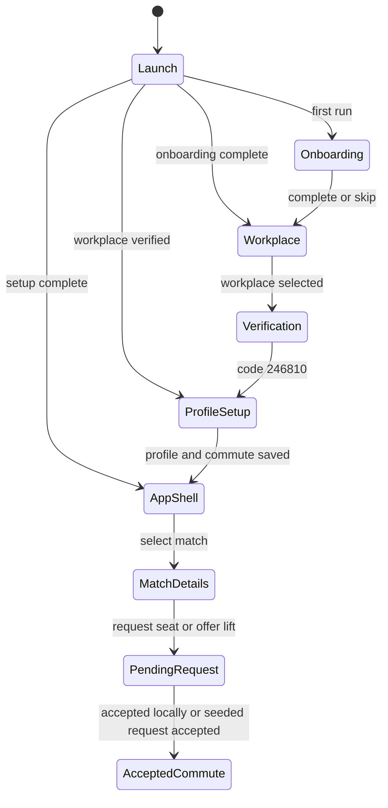

# Coleggo rapid prototype implementation plan

**Product:** Coleggo  
**Tagline:** Go to work together  
**Plan date:** 14 July 2026  
**Target:** A polished, local-only Flutter vertical slice suitable for product demonstration

## Summary

Build Coleggo as a feature-first Flutter application using Material 3, Riverpod, `go_router`, `shared_preferences`, local Dart fixtures, and `intl`. The prototype will demonstrate the complete journey from onboarding and mock workplace verification through profile and commute setup, explainable colleague matching, request management, and accepted recurring commutes. It will persist important state locally while keeping every production integration explicitly out of scope.

The two-hour constraint is a prioritisation device. The implementation order protects the critical journey first, then adds breadth and polish. The prototype should feel approximately 70% complete in UI and interaction terms, but it must not imply that safety, identity, driving, or insurance checks exist.

---

## Repository findings

The target directory was empty at inspection time.

- No Git repository or Git history was present.
- No `pubspec.yaml` or Flutter project existed.
- No `lib/`, `android/`, `assets/`, or `test/` directories existed.
- No README, architecture guidance, or existing `AGENTS.md` existed.
- No TODO or FIXME comments existed.
- There was no uncommitted work to preserve.
- Flutter was installed at `/opt/homebrew/bin/flutter`.
- Installed toolchain: Flutter 3.41.1 stable, Dart 3.11.0, DevTools 2.54.1.

This is therefore a greenfield prototype rather than an extension of existing functionality.

## Current failures and baseline checks

- `git status --short --branch` failed because the directory was not a Git repository.
- The initial combined Flutter check did not produce complete output and returned a non-zero result.
- `flutter analyze` against the empty directory reported `No issues found`, but this is not a meaningful application check because no Flutter project existed.
- `flutter test` failed because the `test` directory did not exist.
- The separate `flutter pub get` retry was cancelled before execution, and it would not have been applicable without `pubspec.yaml`.

After scaffolding, dependency resolution, analysis, and tests must all be run again and their results treated as the actual implementation baseline.

---

## Product scope

### Included

- Launch and session restoration.
- Three-page onboarding with skip and completion actions.
- Search and selection across at least five fictional workplaces.
- Mock work email entry, simulated code delivery, and code `246810` verification.
- Commuter profile setup with name, initials avatar, role, approximate area, worksite, commuting days, and preferred times.
- Driver, passenger, and dual-role experiences.
- Commute creation and editing.
- Deterministic estimated compatibility scoring with visible reasons.
- At least 18 fictional commuter profiles and 12 useful route matches.
- Match profile and privacy-safe journey details.
- Seat requests and lift offers with confirmation and pending state.
- Seeded incoming requests with accept and decline actions.
- Pending, accepted, declined, and cancelled request examples.
- Accepted recurring commute details.
- Local persistence for onboarding, verification, profile, commute, requests, accepted commute, theme, and current shell tab where practical.
- Bottom navigation for Home, Matches, Requests, and Profile.
- Material 3 light and dark themes with responsive layouts.
- Empty, loading, validation, and recoverable error treatments.
- Safety and privacy explanations.

### Deliberately postponed

- Real authentication or account recovery.
- Real company email or invitation verification.
- Firebase, Supabase, or any production backend.
- Live GPS, geocoding, route APIs, Google Maps, or Mapbox.
- Exact locations, precise coordinates, or movement history.
- Real-time chat and presence.
- Push notifications.
- Fares, payments, advertisements, or commercial transport features.
- Identity document, licence, insurance, criminal record, or driving ability verification.
- Production analytics, crash reporting, observability, remote configuration, or feature flags.
- Deep links and production release automation.
- Server-side conflict resolution, multi-device sync, and offline reconciliation.

---

## Proposed architecture

Use a pragmatic feature-first architecture with a small domain/data seam.

```text
Widgets and screens
        |
Riverpod controllers and providers
        |
Repository interfaces
        |
Local mock repository implementations
        |
Dart fixtures + SharedPreferences snapshot
```

### Architectural decisions

1. **Single app state snapshot:** Keep prototype user progress in one serialisable `AppState` aggregate. Persist it as versioned JSON in `shared_preferences`. This limits prototype persistence complexity and provides one deterministic restore path.
2. **Repository boundaries:** Define `WorkplaceRepository`, `ProfileRepository`, `CommuteRepository`, `MatchRepository`, and `RideRequestRepository`. Their local implementations can later be replaced without changing screens.
3. **Riverpod only:** Use Riverpod for state, dependency injection, asynchronous bootstrapping, and mutation orchestration. Do not introduce Provider, Bloc, GetX, or generated state classes.
4. **Router redirects:** `go_router` chooses launch, onboarding, verification, setup, or the app shell based on restored state. A stateful indexed shell preserves tab navigation stacks where practical.
5. **Deterministic fixtures:** Use fictional Dart fixtures to avoid asset-loading failure modes and code generation. Data is clearly labelled as fictional in UI and documentation.
6. **Estimated matching:** Score predefined area affinity rather than geographic routes. UI always calls the result an estimated compatibility score.
7. **Privacy by default:** Match details expose approximate areas, broad corridors, departure windows, role, seats, worksite, and vehicle summary only. No hidden precise personal fields are stored in fixtures.
8. **Responsive Material 3:** Use width constraints and adaptive grids rather than separate phone and tablet implementations.

### State flow



### Request lifecycle

Allowed prototype transitions:

- Draft confirmation to pending.
- Incoming pending to accepted or declined.
- Outgoing pending to cancelled.
- Accepted remains accepted and appears as a recurring commute.
- Declined and cancelled remain visible as history.

No transition should silently disappear a request.

---

## Output structure and files

```text
AGENTS.md
README.md
pubspec.yaml
android/
assets/
  mock/
    README.md
lib/
  main.dart
  app/
    app.dart
    router.dart
    theme.dart
  core/
    constants/
      app_constants.dart
    extensions/
      context_extensions.dart
    utils/
      formatters.dart
    widgets/
      app_scaffold.dart
      empty_state.dart
      profile_avatar.dart
      compatibility_indicator.dart
      status_chip.dart
      workplace_badge.dart
      section_card.dart
  data/
    models/
      app_state.dart
      commute.dart
      commuter_profile.dart
      match_result.dart
      ride_request.dart
      workplace.dart
    repositories/
      repository_interfaces.dart
      local_repositories.dart
    services/
      local_storage_service.dart
      matching_service.dart
    mock/
      mock_data.dart
  features/
    launch/
      launch_screen.dart
    onboarding/
      onboarding_screen.dart
    workplace/
      workplace_search_screen.dart
      verification_screen.dart
    profile/
      profile_setup_screen.dart
      profile_screen.dart
      settings_safety_screen.dart
    commute/
      commute_form_screen.dart
      accepted_commute_screen.dart
    home/
      home_screen.dart
    matches/
      matches_screen.dart
      match_details_screen.dart
      request_confirmation_screen.dart
    requests/
      requests_screen.dart
    shell/
      app_shell.dart
    state/
      app_controller.dart
      providers.dart
test/
  app/
    app_navigation_test.dart
  data/
    matching_service_test.dart
    local_storage_service_test.dart
  features/
    primary_journey_test.dart
    requests_test.dart
```

The implementer may consolidate small files when that materially improves build speed, but repository interfaces, matching logic, state control, and presentation must remain separable.

---

## Dependencies to add

### Runtime

- `flutter_riverpod`: state management and dependency injection.
- `go_router`: declarative routing and guarded setup flow.
- `shared_preferences`: lightweight versioned local persistence.
- `intl`: UK-friendly date and time labels.
- Flutter SDK Material libraries.

### Development

- `flutter_test` from the Flutter SDK.
- `flutter_lints` for static analysis.

Do not add code generation, networking, mapping, image-loading, database, authentication, or analytics packages.

---

## Fictional mock data specification

### Companies

Use at least five visibly fictional organisations, for example:

- Northstar Works
- Bramble & Finch
- Alderline Systems
- Kestrel Civic Labs
- Harbourlight Studios

Every workplace selection surface must state that organisations and people are fictional prototype data.

### Worksites

Provide at least eight fictional UK-style sites across the fictional organisations, such as Central Exchange, Canal Quarter Campus, Northfield House, Harbour Point, Foundry Park, Kingsmead Centre, Willow Court, and Station Yard.

### Profiles

Provide at least 18 fictional commuters with:

- invented first names and initials-only avatars;
- a mix of driver, passenger, and both roles;
- morning, early, and late shifts;
- varied weekday sets;
- approximate areas and broad corridors;
- zero to four available seats;
- optional non-identifying vehicle summaries for drivers;
- verified workplace status;
- no private email, telephone, exact address, coordinate, or complete registration fields.

### Requests and commutes

Seed:

- incoming pending requests that can be accepted or declined;
- outgoing pending requests;
- accepted, declined, and cancelled history;
- at least one accepted recurring commute;
- empty-state support when filters or state yield no results.

---

## Matching model

`MatchingService` computes an integer score from 0 to 100 using five independent components:

| Component | Weight | Prototype calculation |
| --- | ---: | --- |
| Route-area compatibility | 35 | Predefined same-area, neighbouring-area, same-corridor, or unrelated affinity |
| Time compatibility | 25 | Difference between preferred relevant times, with full credit within 15 minutes and tapered bands after that |
| Worksite | 20 | Full credit only for the same worksite |
| Commute days | 15 | Proportional overlap against the requesting commuter's selected days |
| Role and seats | 5 | Compatible driver/passenger roles and at least one seat where required |

Rules:

- Clamp every final score to 0 to 100.
- Exclude users with no useful role compatibility.
- Sort by score descending, then first name for deterministic ties.
- Return human-readable reasons generated from the scored facts.
- Never describe predefined area affinity as a measured route.
- Label every score as estimated.
- Include reasons such as `Same worksite`, `Three matching commute days`, `Departure times are within 15 minutes`, `Starts from a nearby area`, and `Two seats available` only when true.

---

## Design system

### Visual character

Coleggo should feel calm, trustworthy, social, and workplace appropriate, not transactional or taxi-like. Use an evergreen and warm coral palette, soft neutral surfaces, generous whitespace, and simple route motifs built from Flutter shapes and icons.

### Tokens

- Spacing: 4, 8, 12, 16, 24, 32, and 48 logical pixels.
- Corners: 12 for controls, 16 for cards, 24 for prominent panels.
- Minimum touch target: 48 logical pixels.
- Content maximum width: approximately 720 for forms and 1120 for dashboards.
- Typography: Material 3 type scale with clear title, supporting text, and metadata hierarchy.

### Components

- Rounded section and journey cards.
- Initials avatars with stable colour gradients.
- Workplace verification badge with an explanatory tooltip or supporting text.
- Request status chips with semantic colour and text, never colour alone.
- Circular or linear estimated compatibility indicator.
- Day chips and time-window labels.
- Prominent but non-aggressive primary actions.
- Skeleton or progress treatment during app restoration.
- Empty states with widget-drawn iconography and actionable copy.

### Themes and responsiveness

- Light and dark `ColorScheme` definitions.
- System theme default plus explicit light, dark, and system setting.
- High contrast between text and surfaces.
- One-column mobile forms and adaptive two-column/grid dashboard content on wider layouts.
- Bottom navigation on compact widths. A wider navigation rail is optional only after the vertical slice is complete.

---

## Implementation phases

### Phase 0: scaffold and quality baseline

**Goal:** Create a valid Flutter project and establish dependencies, analysis, assets, and project guidance.

**Files:** `pubspec.yaml`, `analysis_options.yaml`, platform scaffold, `README.md`, `AGENTS.md`, and `assets/mock/README.md`.

**Acceptance:** Dependencies resolve; the generated counter sample is removed; formatting, analysis, and the initial test suite can run.

### Phase 1: domain, fixtures, matching, and persistence

**Goal:** Make the complete product flow possible without UI coupling.

**Files:** models, repository interfaces and local implementations, `mock_data.dart`, `matching_service.dart`, `local_storage_service.dart`, app controller, and data tests.

**Acceptance:** The fixture counts meet the requested minimums; score weights total 100; matching is deterministic and explainable; state round-trips through local storage; request transitions are explicit.

### Phase 2: app shell, launch, theme, and navigation

**Goal:** Restore local state and route users to the correct stage while preserving four-tab shell state.

**Files:** `main.dart`, app, router, theme, shell, shared widgets, and navigation tests.

**Acceptance:** First run opens onboarding; restored setup opens Home; Home, Matches, Requests, and Profile tabs retain practical state; light and dark modes render.

### Phase 3: onboarding, workplace verification, and setup

**Goal:** Complete the path to a usable commuter profile and first commute.

**Files:** onboarding, workplace search, verification, profile setup, and commute form screens.

**Acceptance:** Users can skip or complete onboarding, choose a fictional workplace, enter a work email, receive a simulated code message, verify only with `246810`, choose all profile fields, and save a commute. Validation prevents incomplete required fields without losing entered data.

### Phase 4: dashboard and explainable matches

**Goal:** Present the next commute and useful colleague matches with clear reasoning.

**Files:** Home, Matches, match details, request confirmation, compatibility and profile components.

**Acceptance:** At least 12 fixture-based matches can be represented; score and reasons are visible; exact/private details are absent; a compatible action is `Request a seat` or `Offer a lift` according to roles.

### Phase 5: requests and accepted recurring commute

**Goal:** Complete both outgoing and incoming request loops.

**Files:** Requests, accepted commute details, request controller mutations, and request tests.

**Acceptance:** Sending creates pending state; seeded incoming pending requests can become accepted or declined; outgoing pending requests can be cancelled; accepted requests expose recurring days, broad corridor, safe meeting point guidance, and no private contact details.

### Phase 6: profile, safety, settings, and polish

**Goal:** Make the slice feel coherent and responsible.

**Files:** Profile, settings and safety, reusable empty/error states, theme selection, README, and primary journey tests.

**Acceptance:** Safety limitations are prominent and accurate; users can edit profile and commute, change theme, reset prototype data, and see polished empty and error states.

---

## Implementation units and test scenarios

### U1. Scaffold the Flutter application

**Dependencies:** None.

**Approach:** Generate only the supported Flutter platforms, retain standard Android configuration, configure package metadata and minimal dependencies, then remove sample counter code.

**Tests:** The app smoke test renders Coleggo rather than the counter sample.

### U2. Define local domain and fixture data

**Dependencies:** U1.

**Approach:** Create immutable serialisable models with explicit enums for role and request status. Build fictional fixtures that contain no prohibited private fields.

**Tests:** Fixture validation confirms five companies, eight worksites, 18 profiles, role diversity, and expected request statuses.

### U3. Implement estimated compatibility

**Dependencies:** U2.

**Approach:** Keep weighted scoring pure and deterministic. The service returns `MatchResult` values containing score breakdown and reasons.

**Tests:** Same worksite contributes 20; close time contributes the appropriate band; day overlap is proportional; incompatible roles are excluded; scores clamp at boundaries; ties are deterministic; every positive component has truthful copy.

### U4. Implement versioned local state

**Dependencies:** U2.

**Approach:** Persist one JSON snapshot with a schema version and safe defaults. Corrupt or unknown data falls back to a fresh state without crashing.

**Tests:** Fresh state loads when no key exists; completed state round-trips; malformed JSON falls back; request changes survive a repository recreation.

### U5. Add app controller and repository providers

**Dependencies:** U2, U3, U4.

**Approach:** Expose local repositories and a single app controller through Riverpod. Mutations update in-memory state then persist it.

**Tests:** Onboarding, verification, profile, commute, request, tab, and theme mutations produce expected state.

### U6. Add theme, launch routing, and shell navigation

**Dependencies:** U5.

**Approach:** Build Material 3 themes and route redirects based on restored state. Use a stateful shell for four tabs and full-screen routes for setup and details.

**Tests:** Fresh state routes to onboarding; verified but incomplete state routes to setup; complete state routes home; all tabs are reachable; theme selection is reflected.

### U7. Build onboarding and workplace verification

**Dependencies:** U6.

**Approach:** Use compact staged screens with fictional-data disclosure. Verification simulates sending and accepts only `246810`.

**Tests:** Skip and complete both advance; empty/invalid work email shows validation; wrong code remains blocked; `246810` advances to profile setup.

### U8. Build profile and commute setup

**Dependencies:** U7.

**Approach:** Use accessible segmented role selection, approximate areas, worksites, weekday chips, time pickers, seat count, and vehicle summary. Exact addresses are never requested.

**Tests:** Required validation is visible; passenger setup does not require vehicle fields; driver setup captures seats and summary; valid submission enters the app shell and survives restart.

### U9. Build dashboard and matches

**Dependencies:** U3, U6, U8.

**Approach:** Show next commute, recurring schedule, request summary, and ranked match cards. Match details explain each weighted reason and repeat the privacy boundary.

**Tests:** Ranked matches use service output; cards identify estimated scores; detail pages omit prohibited data; empty filter results show an actionable empty state.

### U10. Build request and recurring commute flows

**Dependencies:** U5, U9.

**Approach:** Confirm actions before creating outgoing requests. Group requests by incoming, outgoing, and history. Accepted state creates or reveals a recurring commute detail.

**Tests:** Seat request and lift offer become pending; duplicate active request is blocked; incoming request accepts or declines; cancellation works only for outgoing pending requests; accepted detail displays recurring days and safety guidance.

### U11. Build profile, settings, and safety

**Dependencies:** U6, U8.

**Approach:** Present editable summaries, workplace badge explanation, theme control, reset action, and complete prototype safety limitations.

**Tests:** Theme choice persists; reset requires confirmation and returns to onboarding; safety screen contains workplace, driving, insurance, and public pickup guidance.

### U12. Final vertical-slice verification and polish

**Dependencies:** U1 through U11.

**Approach:** Run the complete journey at compact and wide widths in light and dark modes. Fix overflow, misleading copy, dead ends, inconsistent state, and inaccessible controls before optional decoration.

**Tests:** A primary journey widget test covers onboarding to pending request; a request test covers seeded acceptance to recurring commute; all unit and widget tests, formatting, and analysis pass.

---

## Ordered task list

1. Create the Flutter scaffold and package metadata.
2. Add Riverpod, `go_router`, `shared_preferences`, and `intl`.
3. Add project instructions, README, analysis settings, and asset declarations.
4. Define enums and models for workplaces, profiles, commutes, matches, requests, and application state.
5. Create fictional companies, worksites, commuters, area relationships, requests, and recurring commute fixtures.
6. Implement and test deterministic compatibility scoring.
7. Implement and test versioned `shared_preferences` state persistence.
8. Implement repository interfaces, local repositories, Riverpod providers, and app controller.
9. Add Material 3 light/dark themes and reusable visual components.
10. Add launch restoration, route guards, and state-preserving bottom navigation.
11. Build onboarding, workplace search, and mock verification.
12. Build profile and initial commute setup.
13. Build Home and ranked Matches.
14. Build match details and send-request confirmation.
15. Build Requests with accept, decline, and cancel actions.
16. Build accepted recurring commute details.
17. Build Profile, edit commute, settings, safety, theme, and reset.
18. Add empty, loading, validation, and error states.
19. Add unit and widget tests for the highest-value flows.
20. Format, analyse, test, and manually review compact/wide and light/dark UI.

### Two-hour prioritisation cut line

If time becomes constrained, preserve tasks 1 through 16 and simplify visual decoration. Do not cut truthful safety copy, privacy boundaries, deterministic matching reasons, state persistence, or the outgoing/incoming request loop. Tasks 17 through 20 should then focus narrowly on safety information and verification rather than additional animation or illustration.

---

## Acceptance criteria

### Critical journey

- A first-time user can complete or skip onboarding.
- All companies, worksites, and people are clearly fictional.
- The user can choose a workplace and enter a work email.
- The UI simulates code receipt and accepts `246810`.
- The user can create a profile as Driver, Passenger, or Both.
- The app asks for an approximate area, never an exact address.
- The user can select a worksite, commuting days, arrival/departure times, and driver seat details where relevant.
- Saving setup creates a commute and opens the four-tab shell.
- Matches are ordered by an estimated 0 to 100 score.
- Every match shows truthful, human-readable reasons.
- The user can inspect a privacy-safe match profile.
- The primary action adapts between requesting a seat and offering a lift.
- Sending creates a visible pending request.
- A seeded incoming request can be accepted or declined.
- An accepted request produces a recurring commute detail.
- Closing and reopening restores important state.

### Privacy and safety

- No exact address, coordinate, telephone, private email, complete registration, or movement history appears before mutual acceptance.
- The prototype does not store fixture fields for prohibited private data.
- Workplace verification is described as access confirmation, not a character check.
- The prototype states that Coleggo does not verify driving ability, insurance, criminal history, licences, or identity documents.
- Drivers are told they remain responsible for vehicle roadworthiness, licence, and insurance.
- Users are told to choose safe public meeting points.

### UI quality

- Home, Matches, Requests, and Profile are always reachable after setup.
- Navigation state is retained where practical.
- Light and dark themes have intentional surface and status colours.
- Compact phone layouts do not overflow.
- Wider layouts constrain forms and use space effectively.
- Loading, empty, validation, and recoverable error states are designed.
- Status is conveyed with text and iconography, not colour alone.

### Engineering quality

- `flutter pub get` succeeds after scaffolding.
- `dart format` leaves source and tests formatted.
- `flutter analyze` reports no issues.
- `flutter test` passes.
- Mock and production seams are clearly separated by repository interfaces.
- No secrets, API keys, network endpoints, or production service configuration are added.

---

## Risks and mitigations

| Risk | Impact | Mitigation |
| --- | --- | --- |
| Empty repository increases setup work | Less time for polish | Scaffold minimally and avoid optional packages and code generation |
| Two-hour framing conflicts with broad screen count | Shallow or inconsistent interactions | Prioritise one complete journey and reuse components across secondary states |
| Persistence model drifts as fields are added | Restore failures | Use a schema version, defaults, enum fallbacks, and round-trip tests |
| Matching copy overstates geographic accuracy | Misleading product claim | Use predefined area affinity and consistently label scores as estimated |
| Mock verification appears real | Trust and legal confusion | Label the flow as simulated and expose the fixed prototype code contextually |
| Safety badge implies comprehensive vetting | Unsafe inference | Explain exactly what workplace verification does and does not establish |
| Fixtures accidentally resemble real people or employers | Reputational/privacy concern | Use invented first names, initials, and visibly fictional company names |
| Large controller becomes difficult to change | Fragile implementation | Keep pure matching and storage services separate; accept a small aggregate controller only for prototype orchestration |
| Router redirects loop during restoration | Broken startup | Gate redirects on an explicit loading state and cover each progress state in tests |
| Request mutations create impossible states | Demo inconsistency | Centralise allowed transitions and prevent duplicate active requests |
| Dark theme or wide layout receives little attention | Prototype appears unfinished | Reuse semantic colour tokens and include both modes in final verification |

---

## What the rapid prototype includes

A convincing, locally persisted demonstration of Coleggo's core value: verified workplace access, approximate commute preferences, explainable colleague compatibility, privacy-safe profiles, reciprocal ride requests, and recurring commute acceptance. It includes complete primary interactions, fictional data breadth, responsible safety copy, and polished Material 3 presentation.

## What it does not include

It does not establish real identity, trustworthiness, driving competence, legal compliance, insurance status, location accuracy, or commercial transport capability. It has no backend, network dependency, real authentication, messaging, notifications, mapping, tracking, payments, analytics, or production release infrastructure.

## Largest implementation risks

The largest risks are the breadth of the requested UI in a rapid build, ensuring local state remains internally consistent across every screen, and communicating estimated route compatibility and workplace verification without creating false safety claims. The architecture controls these risks by concentrating state mutations, keeping matching pure, persisting a versioned snapshot, and making safety language part of acceptance rather than optional polish.
